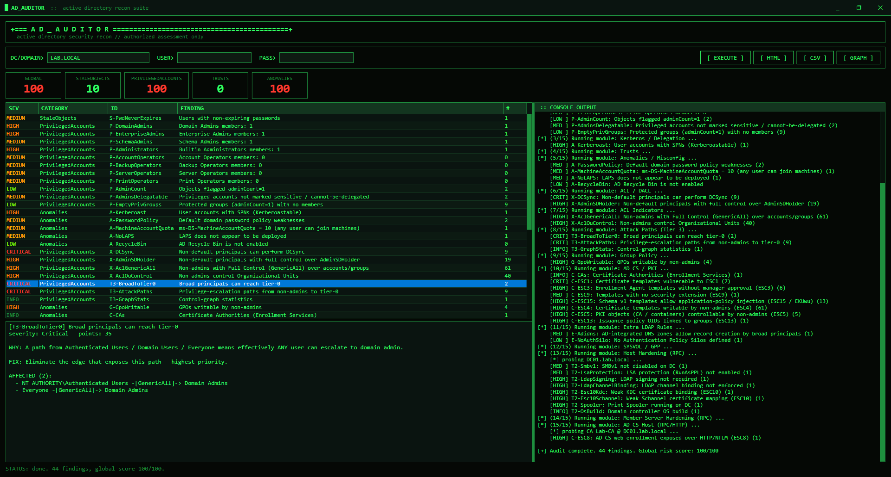

  

<h1 align="center">AD_AUDITOR</h1>

Active Directory security auditing suite with a terminal-style interface.

<a href="README.ru.md">Русская версия</a>

---

**AD_AUDITOR** is a desktop tool for assessing the security posture of an Active Directory domain. It connects to the directory (and, where reachable, to domain controllers, member servers and CAs), runs a broad battery of read-only checks, scores the findings, and presents them in a hacker-terminal-style interface — including an interactive attack-path graph.

## Features

- **128 security rules** across the whole AD attack surface, grouped into four risk domains (Stale Objects, Privileged Accounts, Trusts, Anomalies) with a per-domain and a global risk score (0–100, the worst domain).
- **Account & hygiene**: dormant and never-used accounts, passwords that never expire, accounts with no password required, reversible/DES encryption, end-of-life operating systems (incl. Windows 10 outside LTSC), stale machine passwords, pre-created (pre-Windows 2000) computer accounts.
- **Privileged accounts**: membership of every sensitive group, Kerberoastable and AS-REP-roastable admins, krbtgt and built-in administrator age, DnsAdmins, enabled Guest, broad principals (e.g. Domain Users) inside admin groups, hidden membership via primaryGroupID, admins outside Protected Users or without "cannot be delegated".
- **Kerberos & delegation**: unconstrained, constrained and resource-based delegation, Kerberoasting, AS-REP roasting.
- **ACL attack indicators**: who — other than admins — can take over accounts/groups (GenericAll, GenericWrite, WriteDacl/WriteOwner), reset passwords, modify membership, write Shadow Credentials, read LAPS/gMSA secrets, control OUs and GPO links, perform DCSync or tamper with AdminSDHolder. Inherit-only ACEs that do not apply to the object are ignored.
- **dMSA / BadSuccessor** (Windows Server 2025 schema): who can create or control delegated managed service accounts, and existing dMSA predecessor links.
- **AD Certificate Services**: ESC1–ESC11, ESC13 and ESC15 (ESC1–5/9/13/15 from LDAP — only published templates a non-admin can enroll in; ESC6/7/8/10/11 from the CA and DC hosts).
- **Trusts**: SID filtering (external trusts and SID history on forest trusts), selective authentication, RC4-only trusts, TGT delegation across forest trusts, trust password age.
- **Domain & policy**: password policy, fine-grained (PSO) policies, machine account quota, anonymous LDAP, LAPS coverage (legacy and Windows LAPS), sIDHistory, Kerberos ticket lifetimes, PrivExchange, Azure AD Connect, ADIDNS spoofing and nonsecure DNS updates, authentication policy silos.
- **GPO & SYSVOL**: unlinked and non-admin-writable GPOs, GPO folders writable in SYSVOL, GPP passwords (cpassword), logon/startup scripts, Restricted Groups, dangerous user rights (SeDebug, SeBackup, SeImpersonate, ...) granted to broad principals.
- **Host hardening** (read-only, over the Remote Registry and Service Control Manager): on domain controllers — SMB signing, SMBv1, NTLM level, WDigest, LSA protection, LM hash storage, LDAP signing & channel binding, KDC/Schannel certificate mapping (ESC10), Print Spooler, OS build; on member servers (probed in parallel) — SMB signing, SMBv1, WDigest, LSA protection, Print Spooler, OS build.
- **Attack-path graph (Tier 3)**: builds a control graph (membership, ACLs, delegation, DCSync, local admins and sessions over RPC, Kerberoast/AS-REP/ESC1 vectors) and draws every escalation path from an ordinary account to tier-0, with the recommended break point highlighted, in a colour-coded, zoomable, pannable view; exportable to Graphviz DOT.
- **Reports**: self-contained HTML report, CSV (with spreadsheet-formula protection) and JSON (findings, scores and the attack graph) for pipelines.

## Usage

1. Run the application on a domain-joined Windows machine.
2. Leave **DC/DOMAIN**, **IP**, **USER** and **PASS** empty to audit the current domain with your current credentials, or specify a domain controller / domain name, an optional DC **IP** (used when DNS does not resolve the domain) and an optional `DOMAIN\user` + password.
3. Press **EXECUTE** and watch the live console as each module runs.
4. Review findings in the table; select any row to inspect the affected objects, the reason it matters, and the recommended fix.
5. Open the **GRAPH** view for attack paths, or export the results with **HTML** / **CSV** / **JSON**.

## Requirements & notes

- Windows with the .NET Framework 4.8 runtime.
- Any standard domain user account is enough for the directory checks — domain-admin rights are **not** required.
- Only the LDAP checks use the credentials typed in the UI. SYSVOL reading, host hardening (Remote Registry, Service Control Manager), the AD CS host checks and the Tier 3 local-admin/session sweep use the **current Windows session**; they usually need local admin rights on the target, and unreachable hosts are simply skipped.
- All checks are **read-only**. The tool never modifies the directory and never performs active exploitation. The ESC8 check sends one unauthenticated HTTP GET to `/certsrv/` on each CA.

## Project layout

| Path | What is there |
|---|---|
| `ADAuditor/Core/` | connection and LDAP helpers (`AuditContext`), rule runner (`AuditEngine`), finding/score model, graph model, UAC/trust bit flags |
| `ADAuditor/Checks/` | one module per area: `Stale`, `Privileged`, `Delegation`, `Trust`, `Anomaly`, `Acl`, `AdvancedAcl`, `BadSuccessor`, `Gpo`, `Cert`, `LdapExtra`, `Tier3Graph` (+ `RpcCollector`), `Sysvol`, `Tier2Host`, `Tier2Member`, `Tier2Ca`; shared helpers in `CheckUtil` |
| `ADAuditor/Report/` | HTML, CSV, JSON and Graphviz DOT writers |
| `ADAuditor/MainWindow.*`, `GraphWindow.*`, `WinChrome.cs`, `App.xaml` | terminal-style UI, attack-path view, custom window chrome, theme |
| `scripts/Seed-LabVulns.ps1` | seeds deliberate weaknesses in an isolated lab domain (`-Cleanup` reverts them) |
| `scripts/Harden-Lab.ps1` | remediates the lab findings |
| `CHANGELOG.md` | version history |

Build: `dotnet build ADAuditor.sln -c Release` → `ADAuditor/bin/Release/net48/ADAuditor.exe`.

## Disclaimer

This tool is intended for **authorized security assessment of your own environment** only. Use it only where you have explicit permission.
