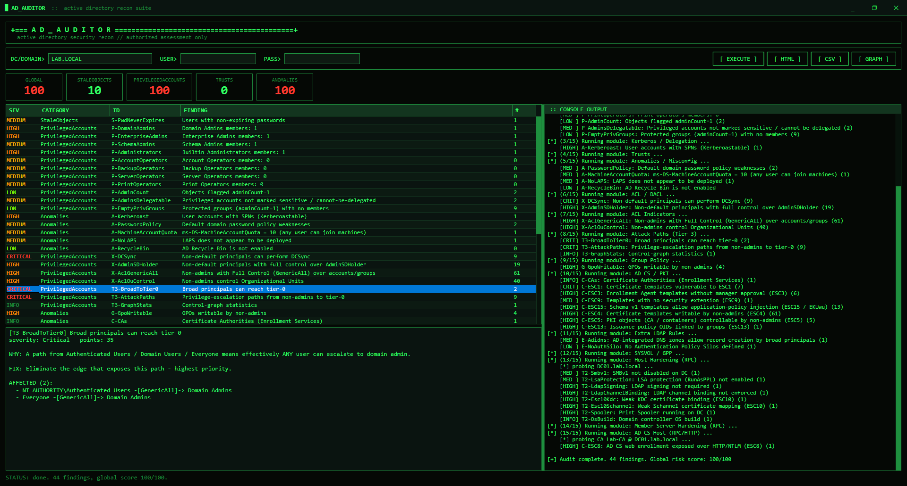

  

<h1 align="center">AD_AUDITOR</h1>

Набор для аудита безопасности Active Directory с интерфейсом в стиле терминала.

<a href="README.md">English version</a>

---

**AD_AUDITOR** — настольный инструмент для оценки защищённости домена Active Directory. Он подключается к каталогу (а там, где доступны, — к контроллерам домена, рядовым серверам и центрам сертификации), выполняет широкий набор проверок только на чтение, выставляет оценку риска и показывает результаты в интерфейсе в стиле хакерского терминала — включая интерактивный граф путей атак.

## Возможности

- **128 правил безопасности** по всей поверхности атаки Active Directory, сгруппированных в четыре домена риска (устаревшие объекты, привилегированные учётки, трасты, аномалии) с оценкой по каждому домену и общей оценкой риска (0–100, по худшему домену).
- **Учётки и гигиена**: спящие и ни разу не использованные учётки, непросрочиваемые пароли, учётки без обязательного пароля, обратимое/DES-шифрование, снятые с поддержки ОС (включая Windows 10 вне LTSC), старые машинные пароли, заранее созданные компьютеры «pre-Windows 2000».
- **Привилегированные учётки**: состав всех чувствительных групп, администраторы, уязвимые к Kerberoasting и AS-REP roasting, возраст krbtgt и встроенного администратора, DnsAdmins, включённый Guest, широкие принципалы (например, Domain Users) внутри админских групп, скрытое членство через primaryGroupID, администраторы вне Protected Users или без флага «нельзя делегировать».
- **Kerberos и делегирование**: неограниченное, ограниченное и ресурсное делегирование, Kerberoasting, AS-REP roasting.
- **Индикаторы атак через ACL**: кто, кроме администраторов, может захватить учётки/группы (GenericAll, GenericWrite, WriteDacl/WriteOwner), сбросить пароль, изменить членство, записать Shadow Credentials, прочитать секреты LAPS/gMSA, управлять OU и привязкой GPO, выполнить DCSync или подменить AdminSDHolder. Записи «только для наследования», не действующие на сам объект, не учитываются.
- **dMSA / BadSuccessor** (схема Windows Server 2025): кто может создать делегированную управляемую учётку службы или управлять ею, и существующие связи dMSA с предшественником.
- **Службы сертификации (AD CS)**: ESC1–ESC11, ESC13 и ESC15 (ESC1–5/9/13/15 — по LDAP, только опубликованные шаблоны, на которые может записаться не-администратор; ESC6/7/8/10/11 — с хостов ЦС и контроллеров).
- **Трасты**: фильтрация SID (внешние трасты и SID history на лесных трастах), выборочная аутентификация, трасты только с RC4, делегирование TGT через лесной траст, возраст пароля доверия.
- **Домен и политики**: парольная политика, точечные политики (PSO), квота на создание компьютеров, анонимный LDAP, покрытие LAPS (старый и Windows LAPS), sIDHistory, сроки жизни билетов Kerberos, PrivExchange, Azure AD Connect, спуфинг ADIDNS и небезопасные обновления DNS, политики аутентификационных силосов.
- **GPO и SYSVOL**: непривязанные GPO и GPO, доступные на запись не-администраторам, папки GPO в SYSVOL с правом записи, пароли GPP (cpassword), скрипты входа/запуска, Restricted Groups, опасные права пользователей (SeDebug, SeBackup, SeImpersonate и др.), выданные широким группам.
- **Закалка хостов** (только чтение, через Remote Registry и диспетчер служб): на контроллерах домена — SMB signing, SMBv1, уровень NTLM, WDigest, защита LSA, хранение LM-хешей, подпись и channel binding для LDAP, сопоставление сертификатов KDC/Schannel (ESC10), Print Spooler, версия ОС; на рядовых серверах (опрос параллельный) — SMB signing, SMBv1, WDigest, защита LSA, Print Spooler, версия ОС.
- **Граф путей атак (Тир 3)**: строит граф контроля (членство, ACL, делегирование, DCSync, локальные администраторы и сеансы по RPC, векторы Kerberoast/AS-REP/ESC1) и рисует все пути эскалации от обычной учётки до тир-0 с подсветкой рекомендуемой точки разрыва, в цветном масштабируемом перемещаемом виде; выгрузка в Graphviz DOT.
- **Отчёты**: самостоятельный HTML-отчёт, CSV (с защитой от формул в таблицах) и JSON (находки, оценки и граф атак) для пайплайнов.

## Использование

1. Запустите приложение на машине, входящей в домен.
2. Оставьте поля **DC/DOMAIN**, **IP**, **USER** и **PASS** пустыми, чтобы проверить текущий домен под своей учётной записью, либо укажите контроллер/имя домена, при необходимости **IP** контроллера (если DNS не разрешает домен) и `DOMAIN\user` + пароль.
3. Нажмите **EXECUTE** и наблюдайте за живым логом по мере работы модулей.
4. Изучите находки в таблице; выберите строку, чтобы увидеть затронутые объекты, причину важности и рекомендацию по исправлению.
5. Откройте вид **GRAPH** для путей атак или выгрузите результаты кнопками **HTML** / **CSV** / **JSON**.

## Требования и примечания

- Windows со средой выполнения .NET Framework 4.8.
- Для проверок каталога достаточно любой обычной доменной учётной записи — права администратора домена **не нужны**.
- Введённые в интерфейсе учётные данные используются только для LDAP. Чтение SYSVOL, закалка хостов (Remote Registry, диспетчер служб), проверки хостов AD CS и сбор локальных администраторов/сеансов для Тир 3 идут под **текущей Windows-сессией**; обычно для них нужны права локального администратора на цели, недоступные хосты просто пропускаются.
- Все проверки выполняются **только на чтение**. Инструмент не изменяет каталог и не проводит активную эксплуатацию. Проверка ESC8 отправляет на каждый ЦС один GET-запрос без учётных данных к `/certsrv/`.

## Что где лежит

| Путь | Что там |
|---|---|
| `ADAuditor/Core/` | подключение и помощники LDAP (`AuditContext`), запуск правил (`AuditEngine`), модель находок и оценок, модель графа, флаги UAC и трастов |
| `ADAuditor/Checks/` | по модулю на область: `Stale`, `Privileged`, `Delegation`, `Trust`, `Anomaly`, `Acl`, `AdvancedAcl`, `BadSuccessor`, `Gpo`, `Cert`, `LdapExtra`, `Tier3Graph` (+ `RpcCollector`), `Sysvol`, `Tier2Host`, `Tier2Member`, `Tier2Ca`; общие помощники в `CheckUtil` |
| `ADAuditor/Report/` | выгрузка HTML, CSV, JSON и Graphviz DOT |
| `ADAuditor/MainWindow.*`, `GraphWindow.*`, `WinChrome.cs`, `App.xaml` | интерфейс в стиле терминала, окно графа, своя рамка окна, тема |
| `scripts/Seed-LabVulns.ps1` | закладывает уязвимости в изолированный лабораторный домен (`-Cleanup` откатывает) |
| `scripts/Harden-Lab.ps1` | устраняет находки в лаборатории |
| `CHANGELOG.md` | история версий |

Сборка: `dotnet build ADAuditor.sln -c Release` → `ADAuditor/bin/Release/net48/ADAuditor.exe`.

## Отказ от ответственности

Инструмент предназначен только для **авторизованной оценки безопасности собственной инфраструктуры**. Используйте его лишь там, где у вас есть явное разрешение.
